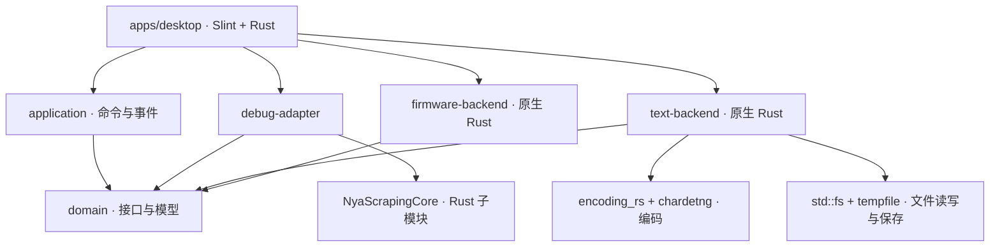
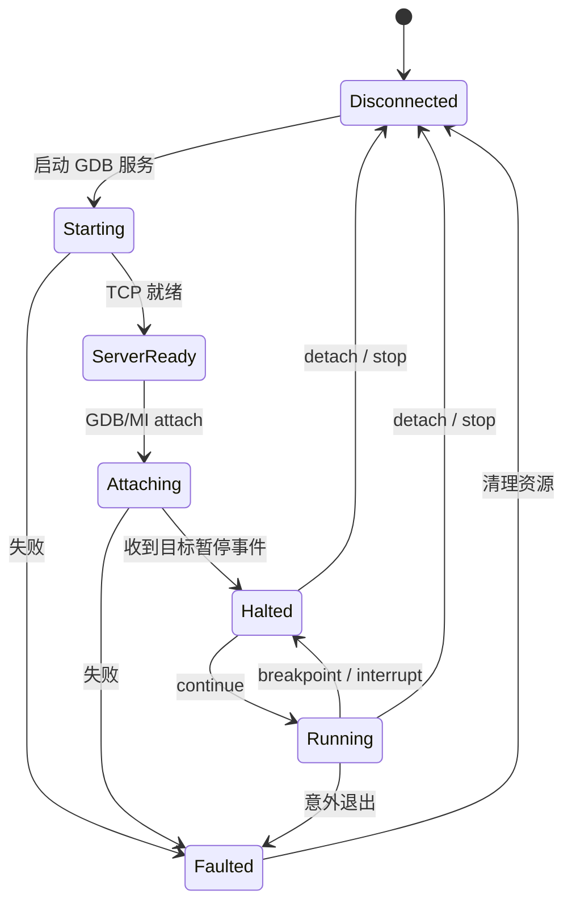

# 架构设计

## 依赖方向

`domain` 不依赖 Slint 或外部进程。`application` 只使用领域接口。`desktop` 是依赖组装入口，持有 Slint 模型，注册界面回调。调试后端子模块排除在父 workspace 外，保留独立构建和发布边界；文本后端直接作为 workspace 成员开发。

## 职责与当前落地

| 模块 | 负责 | 当前实现 |
| --- | --- | --- |
| domain | 目标配置、会话状态、监视值、工具与文本接口 | 有界缓冲、标量解码、批量读取计划与绘图包络 |
| application | 操作编排、命令和事件 | 工具刷新/安装/选择/卸载、打开源码、解析编译产物 |
| firmware-backend | 编译产物静态解析 | ELF/AXF、PE/COFF、Mach-O；段、节、符号表及 DWARF 函数/变量/类型/声明位置 |
| debug-adapter | 调用 NyaScrapingCore | 工具发现/安装/选择/卸载、GDB 服务启停、烧录、复位的适配接口 |
| text-backend | 原生 Rust 文本处理 | 读取、编码检测/转换、保留编码/BOM/换行的保存 |
| desktop | 工作线程、模型映射、窗口生命周期 | 页面布局、工具列表、只读源码预览、编译产物报告、共享波形/监视采集与绘图 |

适配接口存在不代表界面功能已经接通。工具管理和 GDB/MI 调试操作已通过命令/事件接入界面；真实探针与下载仍需要硬件验收。

## 线程与生命周期

UI 回调将命令写入容量为 8 的队列，工作线程调用应用用例，并通过 `PreparedEvent` 完成固件文件树构建、排序和报告格式化，随后用 `Weak::upgrade_in_event_loop` 将事件送回 Slint 主线程。只有主线程创建、修改 Slint 模型。此模式遵循 [Slint 的线程通信接口](https://docs.slint.dev/latest/docs/rust/slint/fn.invoke_from_event_loop)。

当前队列串行处理工具管理和文件读取，页面按钮在执行时禁用，UI 忙碌期间拒绝重复提交；关闭窗口会设置退出标志并等待当前有界调试命令结束，再回收会话。工具操作完成或失败后均重新扫描状态。安装日志目前输出到启动终端；任务 ID、超时、取消与长任务退出仍待接入。

GDB 服务句柄由 `DebugAdapter` 独占，停止或释放句柄时由 NyaScrapingCore 清理子进程。烧录、复位在已有服务时被拒绝，避免多个进程争用探针。未来每个物理探针应有独立的排他任务队列；不要只以 TCP 端口判断探针是否空闲。

## 调试与变量

NyaScrapingCore 当前能管理调试工具，生成烧录/擦除/复位命令，管理 GDB 服务并启动交互式 GDB。它没有面向 GUI 的结构化 GDB/MI 结果、变量树、断点事件或采集协议。

`DebugBackend` 负责现有硬件操作，`DebugSession` 提供调试命令、异步轮询与会话快照，两者分开。服务端 TCP 就绪只对应 `ServerReady`，不能直接标为已连接目标或已暂停。

`debug-adapter::mi` 启动 `gdb --interpreter=mi2 --nx --quiet`，解析带 token 的结果、嵌套 tuple/list、C 字符串和异步运行/停止记录。stdout/stderr 读取使用有界队列和单行长度限制；命令超时使会话失效，后续轮询清理子进程。`session` 维护 GDB、调用栈、当前帧和断点；连接时复用选中后端或连接已有本机服务，只有读取实际线程状态后才报告运行/暂停。

工作线程每 60 ms 空闲轮询，`DebugUpdated` 区分命令完成与异步通知，避免异步通知错误解锁忙碌界面。监视请求通过单个可覆盖槽合并，避免快速增删产生积压；每行附带列表修订号，旧快照不会填充新条目。暂停时用临时 var-object 读取值和类型并立即删除；继续执行后清除值。每轮最多 128 项、总求值时间有界，单次变量命令超时为 700 ms。文件变量按源文件限定，局部变量验证当前帧函数，结构体成员保留静态层级并按成员路径求值。

断点 ID 使用 GDB 返回值，支持添加和删除；调用栈最多读取 64 帧，点击切换求值上下文。本机可读源码由文本后端在工作线程打开。复位通过 `monitor reset halt`，下载通过 `-target-download`，只有暂停时可用。下载不由连接动作隐式触发。断开和退出会释放客户端及自有服务端；已有外部服务不由程序终止。

状态流规划：

## 波形与监视数据

波形链路分三层：`debug-adapter::live_memory::OpenOcdMemoryReader` → `desktop::acquisition` 的每通道缓冲 → `Presenter` 快照与 `waveform_view` 栅格化。左侧右键菜单使用菜单所在行的变量身份，右侧开关使用同一 `WatchEntry::waveform` 状态，最多 16 路波形及合计 64 路内存监视。重新加载固件会停止采集并清空旧通道，未解析手动表达式保留。

固件后端从 DWARF 基础类型编码递归解析标量表示，不按类型名猜测。仅静态地址、大小已知的数值变量可采集；不对运行中栈帧求值，不将指针、数组或结构体当成整数。字节序来自固件镜像；可重定位/动态镜像无已解析运行地址时拒绝加入通道。

`ReadPlan` 合并相邻/重叠地址，保留通道到读取块的映射，不跨越未选中的地址间隙。OpenOCD 适配器通过持久 Tcl RPC 连接将所有块合成一条只读请求，按自然对齐选择 8/16/32 位读取。使用 TCP_NODELAY、500 ms 连接/写入超时、整帧 500 ms 截止时间和 64 KiB 响应上限。不注入目标代码、不调用 GDB，不发送暂停、继续、复位或写入命令。依据 [Tcl RPC](https://openocd.org/doc-release/html/Tcl-Scripting-API.html) 和 [read_memory](https://openocd.org/doc/html/General-Commands.html) 实现；目标运行中读取能力仍取决于芯片/探针，失败会停止并显示原始错误。

采集工作线程在响应后立即读取下一轮，网络阻塞提供背压，不逐点投递 UI 事件。`SampleBuffer` 预分配 32768 点，时间为主机请求起止中点相对采集开始的单调时间，拒绝非有限值和倒退时间；缓冲写满淘汰旧点并计数。UI 每 33 ms 读取最新值，波形页可见时提取最近 5 秒的每像素 min/max 包络；释放采集锁后再绘图、更新 Slint 模型。没有新样本或状态变化时不重绘，更新数据行保留列表模型和滚动位置。

通道/连接配置包含递增 revision；完成的读取仅在 revision 一致时提交，避免移除变量、重载固件或停止后提交旧数据。无任务时通过条件变量睡眠；关闭窗口唤醒工作线程，通信超时保证正常服务未响应时能够退出。网络错误终止本次采集，不无限重试，也不伪造数据。

内存读取不消耗目标端采样代码的 CPU 周期，但可能争用总线或受到数据缓存影响；采样率、64 位读的一致性、跨通道同步和短脉冲捕获均无硬件保证。当前显示主机测得的平均采集频率、保留点数、淘汰点数及非有限值数。触发、游标、缩放、CSV 导出和 RTT/SWO 后端留待后续实现，硬件吞吐量及对目标执行的影响需实测。

监视刷新复用同一采集器：`ChannelData::waveform` 区分连续波形与仅监视通道。波形每轮读取，监视按 `monitor_interval` 到期并入同一 RPC；无波形时用可唤醒的条件变量等待下一次监视截止时间，避免忙等。添加监视、调整频率、关闭监视或切换波形角色会更新 revision 和读取计划，保持同一 TCP 连接、采集 epoch 及未移除通道的样本。仅监视的新通道缓冲容量为 1，打开波形时扩容并保留最近值。波形通道优先占用 64 路读取预算，额外监视项需要减少数量。

GDB `sample_watches` 只在目标已暂停时求值；运行中返回空值且不发送 interrupt/continue，应用层抑制这种空周期事件。固定地址数值变量通过采集快照填入监视列表；栈变量、成员或未解析表达式在运行时显示需暂停求值。用户主动写参数、暂停、断开等调试操作仍遵循原有会话语义。

## Rust 原生文本后端

`nya-text-backend` 实现领域层的 `TextBackend` 接口，正文统一使用 Rust UTF-8 `String`，文件路径使用原生 `Path`。它由 `encoding.rs`、`newline.rs` 和文件读写入口组成，内部禁止 unsafe 代码，没有跨语言桥接或原生库构建脚本。

读取先识别 Unicode BOM，其次识别有效 UTF-8，剩余内容由 `chardetng` 推测旧编码，`encoding_rs` 负责严格解码。检测属于启发式判断；`load_with_encoding` 允许显式指定编码，也支持没有 BOM 的 UTF-16。冲突的 BOM、带 BOM 或显式指定编码后的损坏 Unicode、无法按选定编码解码的数据返回错误。当前支持 UTF-8、UTF-16LE/BE 及 encoding_rs 支持的旧编码，不支持 UTF-32。

文档内换行统一为 LF，同时记录主要换行类型与是否混合；U+2028/U+2029 保持原样。保存时按选定换行与编码生成字节，不能编码的字符会导致操作失败。UTF-16 输出使用 Rust 的 UTF-16 码元转换显式处理大小端。编码后的文件大小限制为 128 MiB；读取还通过有界 reader 防止增长文件绕过大小检查。

保存先在目标同目录创建临时文件，写入并同步、保留已有权限，再由 `tempfile::NamedTempFile::persist` 替换目标；提交前的错误不会截断原文件。保存已有符号链接时解析其目标，保留链接本身。读取和保存均使用原生路径，在文件系统允许时也可处理非 UTF-8 文件名；该路径测试仅在 Linux 上执行。

当前源码页面只读。后续编辑需要增量文本模型、撤销栈和视口虚拟化，避免每次输入重新传递整份文档。搜索与编辑接口应明确偏移单位，统一在合法 UTF-8 字符边界操作；与 Slint 选择范围交互时再按其接口约定转换。

## 编译产物解析

`domain::firmware` 定义 `FirmwareBackend` 和静态镜像、段、节、符号模型；`nya-firmware-backend::NativeFirmwareBackend` 使用 `object` 按文件内容解析，不依赖文件扩展名、外部工具或硬件。`parse` 可直接处理内存字节，`load` 使用有界读取并拒绝非普通文件和超过 128 MiB 的输入。校验段和节的文件范围，合计记录数限制为 200000。

`Command::OpenFirmware` 在现有工作线程读取并解析，`Event::FirmwareOpened` 返回完整元数据。ELF AXF 与 ELF 共用解析路径；普通与动态符号保留来源，不合并同名符号。无符号文件仍可读取入口和段信息。

`firmware-backend::dwarf` 通过 `gimli` 解析嵌入式 DWARF 2–5，加载调试节并限制解压大小，通过 `RelocateReader` 应用对象节重定位。首先索引各编译单元 DIE 和父级关系，再解析源码文件表、函数与地址范围、变量与类型引用。`abstract_origin` 和 `specification` 可跨单元继承名称、类型和声明位置；函数体的声明标志直接读取自身 DIE。词法块中的变量保留所属函数，内联实例独立记录。变量位置区分静态地址、表达式、位置列表和不可用，不据此生成运行时监视值。类型引用有循环检测和深度限制。

缺失或解析失败的 DWARF 产生提示，静态镜像信息仍可使用；函数或变量元数据缺失时，以符号表回退并明确缺少源码/类型。外部调试信息暂不加载。编译路径按平台无关规则归一化，不访问或扫描源码目录，也不把虚拟地址当作烧录物理地址。

桌面 `firmware_browser` 将源码文件、函数和所属变量组织成可折叠树，未记录声明位置的条目放入独立分组。Slint `ListView` 仅实例化可见行，选中节点显示详情；原有段/节/符号报告保留在另一标签页，每类至多预览 1000 条。工作线程构建初始树与详情，Presenter 保存展开状态；仅展开/折叠分支时重建可见行，选择变量不替换列表模型。所有 Slint 模型更新仍在 UI 线程。

## 工具与配置

统一使用 `OpenOCD`、`pyOCD`、`probe-rs` 三种工具身份；用户提到的 `probers` 对应 probe-rs。发现、安装、版本选择、卸载直接复用 NyaScrapingCore 的 `Manager`，不另建安装目录或第二份选中版本配置。

桌面当前后端类型保存在 Manager 配置目录下的 `desktop-backend`，工具版本仍由原 Manager 配置保存。`ToolState` 将安装列表与后端类型一并返回 Presenter；选中版本丢失时显示不可用，不自动切换到另一类后端。PATH 重复路径仅首项可选择，系统工具不提供卸载入口。

领域层保存工具类型，适配层才转换为后端枚举。工具路径与参数通过 `std::process::Command` 传递。安装和卸载由显式用户操作触发，发现工具不运行安装脚本；后续工具探测应设置超时，避免异常程序阻塞。

`examples/target-profile.toml` 描述目标配置拟采用的格式，当前尚未实现解析或持久化。目标配置保存工程内可共享的板卡与固件路径；窗口布局、最近打开文件、工具安装路径等用户偏好后续存入用户目录。不要将本机绝对工具路径写入共享工程配置。
